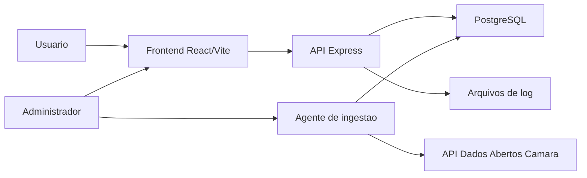

# Documentacao do Sistema Catalogo Politico

## 1. Introducao

O Catalogo Politico, exibido na interface como VotoConsciente/Catalogo Politico, e uma aplicacao web de tecnologia civica criada para facilitar o acesso da populacao a informacoes parlamentares. O sistema centraliza dados publicos sobre politicos, partidos, votacoes, despesas, proposicoes e atividades da Camara dos Deputados, apresentando essas informacoes de forma pesquisavel, visual e compreensivel.

O objetivo principal do projeto e aumentar a transparencia politica e apoiar o acompanhamento cidadao. Em vez de exigir que o usuario consulte varias bases oficiais separadas, a plataforma organiza os dados em telas de ranking, perfis individuais, partidos e atuacao parlamentar.

### Publico-alvo

- Cidadaos interessados em acompanhar representantes politicos.
- Estudantes e pesquisadores que precisam consultar dados parlamentares.
- Jornalistas, analistas e pessoas que desejam comparar gastos, votacoes e desempenho.
- Administradores do proprio sistema, responsaveis por coletar e atualizar dados oficiais.

### Fontes de dados

A base do sistema e formada por dados oficiais e dados gerados pela propria plataforma:

- API de Dados Abertos da Camara dos Deputados.
- Despesas parlamentares.
- Votacoes e votos nominais.
- Proposicoes, eventos, orgaos, frentes parlamentares e referencias.
- Avaliacoes feitas por usuarios.
- Noticias associadas a politicos, quando populadas na base.

## 2. Sistema

### Visao geral da arquitetura

O sistema e composto por uma interface web em React, uma API em Express, um banco PostgreSQL e um agente de ingestao de dados. Em ambiente local, esses componentes podem ser executados por Docker Compose.



### Tecnologias utilizadas

- Frontend: React 19, Vite, TypeScript, Tailwind CSS, React Router e Lucide React.
- Backend: Node.js, Express e TypeScript.
- Banco de dados: PostgreSQL.
- ORM/migrations: Prisma.
- Graficos: Recharts.
- Automacao local: Docker Compose.
- Servicos auxiliares: n8n no Compose para automacoes futuras/integracoes locais.

### Estrutura principal do projeto

- `src/App.tsx`: define as rotas da aplicacao.
- `src/components/Layout.tsx`: navbar, menu, tema claro/escuro e rodape.
- `src/pages/Home.tsx`: pagina inicial com busca e destaques.
- `src/pages/Ranking.tsx`: ranking de politicos e gastos por partido.
- `src/pages/Partidos.tsx`: listagem e detalhamento de partidos.
- `src/pages/PoliticoProfile.tsx`: perfil completo do politico.
- `src/pages/Camara.tsx`: consultas de proposicoes, eventos, orgaos e frentes.
- `src/pages/ProposicaoDetail.tsx`: detalhe de proposicoes.
- `src/pages/Admin.tsx`: painel administrativo de ingestao e limpeza de dados.
- `src/server.ts`: API Express e regras de consulta ao banco.
- `src/ingest-agent.ts`: agente de coleta de dados da Camara.
- `prisma/schema.prisma`: modelo de dados principal.
- `prisma/migrations`: historico de alteracoes do banco.
- `docker-compose.yml`: orquestracao local de app, API, banco e n8n.

### Funcionalidades do usuario

#### Pagina inicial

A tela inicial apresenta a proposta do sistema e permite pesquisar politicos. Tambem exibe destaques como melhores e piores avaliados, alem de novos politicos cadastrados. Os dados sao obtidos por endpoints da API, com filtros de status e limite de registros.

#### Ranking

A pagina de ranking permite comparar politicos por avaliacao e tambem visualizar gastos agregados por partido. A ordenacao e os filtros sao enviados por querystring para a API, evitando que o frontend precise carregar toda a base para ordenar localmente.

#### Perfil do politico

O perfil individual concentra informacoes como:

- Dados cadastrais e partido.
- Foto e detalhes oficiais.
- Avaliacao popular.
- Historico de votacoes.
- Despesas parlamentares.
- Grafico comparando gastos do politico com medias.
- Atuacao parlamentar, incluindo orgaos, eventos, frentes, profissoes e ocupacoes quando disponiveis.

#### Avaliacao popular

O usuario pode avaliar um politico com nota e comentario. Para evitar votos duplicados, o sistema valida o CPF e armazena apenas um hash, sem expor o documento original. Existe uma restricao unica por politico e CPF processado.

#### Partidos

A area de partidos lista siglas, nomes, logos e metricas agregadas. Ao selecionar um partido, o sistema consulta os politicos associados aquela sigla, respeitando filtros de status.

#### Atuacao parlamentar

A pagina Camara permite consultar dados sincronizados da Camara dos Deputados:

- Proposicoes.
- Eventos.
- Orgaos.
- Frentes parlamentares.

As abas usam busca textual e filtros simples, como ano, tipo ou legislatura. Quando uma lista ainda nao foi populada, a interface informa que os dados estao sendo sincronizados.

#### Sobre e metodologia

As paginas Sobre e Metodologia explicam a proposta civica, as fontes de dados, a ideia de transparencia e o funcionamento geral das avaliacoes.

### Funcionalidades administrativas

A rota `/admin` oferece um painel para gerenciar a ingestao de dados oficiais. O administrador pode:

- Escolher periodo inicial e final.
- Selecionar datasets de coleta.
- Definir janela mensal, trimestral ou anual.
- Configurar nivel de paralelismo.
- Iniciar a coleta.
- Acompanhar progresso geral e por dataset.
- Ver checkpoints pendentes, em execucao, concluidos, cancelados ou com falha.
- Cancelar tarefas por grupo.
- Ler logs da ingestao.
- Limpar dados oficiais por categoria antes de uma nova carga.

Os datasets administraveis incluem deputados, despesas, votacoes, legislaturas, partidos, blocos, orgaos, eventos, frentes, proposicoes e referencias.

### API principal

A API Express possui endpoints para consulta publica e administracao. Entre os principais:

- `GET /api/politicos`: lista politicos com busca, paginacao e filtro de status.
- `GET /api/politicos/novos`: lista politicos recentes.
- `GET /api/politicos/ranking`: ranking de politicos.
- `GET /api/politicos/:politicoId`: detalhe do politico.
- `POST /api/politicos/:politicoId/avaliacoes`: cria ou atualiza avaliacao.
- `GET /api/politicos/:politicoId/votacoes`: votacoes do politico.
- `GET /api/politicos/:politicoId/despesas`: despesas do politico.
- `GET /api/politicos/:politicoId/despesas/resumo`: resumo mensal de despesas.
- `GET /api/despesas/media`: media de despesas para comparacao.
- `GET /api/partidos`: lista partidos.
- `GET /api/partidos/gastos`: gastos agregados por partido.
- `GET /api/partidos/:sigla/politicos`: politicos por partido.
- `GET /api/camara/proposicoes`: consulta proposicoes.
- `GET /api/camara/proposicoes/:id`: detalhe de proposicao.
- `GET /api/camara/eventos`: consulta eventos.
- `GET /api/camara/orgaos`: consulta orgaos.
- `GET /api/camara/frentes`: consulta frentes.
- `GET /api/admin/ingestion/summary`: resumo dos checkpoints.
- `GET /api/admin/ingestion/logs`: leitura dos logs da ingestao.
- `POST /api/admin/ingestion/run`: inicia ingestao.
- `POST /api/admin/ingestion/cancel`: cancela tarefas.
- `POST /api/admin/database/clear`: limpa dados por categoria.

### Banco de dados

O banco PostgreSQL armazena entidades politicas, registros oficiais, avaliacoes e dados brutos. Entre as tabelas principais estao:

- `politicos`: dados dos parlamentares.
- `votacoes`: sessoes e votacoes.
- `votos_deputados`: voto de cada politico em uma votacao.
- `despesas`: despesas parlamentares.
- `avaliacoes`: notas e comentarios de usuarios.
- `noticias_politicos`: noticias relacionadas.
- `ingestion_checkpoints`: controle de progresso da ingestao.
- `camara_api_raw_items`: armazenamento bruto de respostas oficiais.
- Tabelas `camara_*`: legislaturas, partidos, blocos, orgaos, eventos, frentes, proposicoes, autores, temas, tramitacoes, relacionadas, orientacoes e referencias.

As migrations criam indices para melhorar consultas por politico, fornecedor, periodo, recurso da Camara e fila de checkpoints.

## 3. DevOps

### Execucao local sem Docker

Requisitos:

- Node.js.
- PostgreSQL acessivel.
- Variavel `DATABASE_URL` ou variaveis `APP_DB_HOST`, `APP_DB_PORT`, `APP_DB_USER`, `APP_DB_PASSWORD` e `APP_DB_NAME`.

Comandos principais:

```bash
npm install
npm run dev
npm run api:dev
```

O frontend roda por padrao na porta `3000`. A API Express roda por padrao na porta `4000`.

### Execucao com Docker Compose

O projeto inclui `docker-compose.yml` com quatro servicos:

- `app`: frontend Vite em desenvolvimento.
- `api`: backend Express em modo watch.
- `db`: PostgreSQL 16 Alpine.
- `n8n`: automacao local conectada ao mesmo banco.

Comando:

```bash
docker compose up --build
```

Portas padrao:

- Frontend: `http://localhost:3000`.
- API: `http://localhost:4000`.
- PostgreSQL: porta local `5434`, encaminhada para `5432` no container.
- n8n: `http://localhost:5679`, salvo se `N8N_HOST_PORT` for alterado.

### Migrations

O projeto usa Prisma para versionar o banco. O entrypoint Docker executa:

```bash
npx prisma migrate deploy
```

Essa execucao depende da variavel `RUN_PRISMA_MIGRATIONS`. No Compose de desenvolvimento ela esta configurada como `false` para os servicos `app` e `api`, evitando aplicar migrations automaticamente a cada subida local.

### Build de producao

O Dockerfile possui tres estagios:

- `development`: instala dependencias e executa o app em modo desenvolvimento.
- `builder`: executa `npm run build`.
- `production`: publica os arquivos finais do Vite com Nginx.

Comando de build local:

```bash
npm run build
```

### CI/CD e automacao

No estado atual do repositorio, nao ha workflow `.github` versionado. A automacao existente esta concentrada em:

- Scripts do `package.json`.
- Dockerfile.
- Docker Compose.
- Migrations Prisma.
- Agente de ingestao acionado pelo painel Admin.
- Servico n8n disponivel no ambiente local.

Para uma entrega futura, recomenda-se adicionar um pipeline de CI com etapas de instalacao, validacao TypeScript, build Vite e, se possivel, testes automatizados.

## 4. Monitoramento

### Logs da aplicacao

O monitoramento mais completo implementado atualmente esta ligado ao processo de ingestao. Quando o administrador inicia uma coleta, a API cria arquivos em `logs/`, usando nomes como `ingest-<timestamp>.log`.

O painel Admin le o arquivo mais recente e apresenta:

- Total de linhas.
- Tarefas iniciadas.
- Tarefas concluidas com dados.
- Tarefas concluidas sem dados.
- Atualizacoes de progresso.
- Retentativas.
- Recursos ignorados.
- Erros HTTP agrupados por status.
- Ultima atividade registrada.

### Checkpoints de ingestao

A tabela `ingestion_checkpoints` funciona como monitoramento operacional. Cada tarefa possui:

- Dataset.
- Entidade.
- Periodo inicial e final.
- Status.
- Numero de tentativas.
- Quantidade de itens processados.
- Ultimo erro.
- Datas de lock, criacao e atualizacao.

Esse controle permite retomar coletas interrompidas, identificar falhas e evitar duplicacao de trabalho.

### Metricas visuais no Admin

O painel administrativo apresenta:

- Progresso de criacao da fila.
- Progresso geral de processamento.
- Percentual por dataset.
- Quantidade de tarefas concluidas, rodando, pendentes e com falha.
- Cobertura populada por dataset e periodo.

### Limites atuais

O sistema ainda nao possui monitoramento externo integrado, como Prometheus, Grafana, Sentry ou alertas por e-mail. O monitoramento atual e suficiente para ambiente academico/local e para acompanhar a carga de dados, mas producao exigiria observabilidade externa.

## 5. Seguranca

### Protecoes implementadas

O projeto possui algumas protecoes importantes no backend:

- Consultas SQL parametrizadas com `pg`, reduzindo risco de SQL injection.
- Whitelist para ordenacao dinamica em endpoints sensiveis.
- Validacao de CPF antes de aceitar avaliacao.
- CPF armazenado como hash SHA-256, nao em texto puro, na tabela de avaliacoes.
- Restricao unica por politico e CPF hasheado, evitando multiplas avaliacoes do mesmo usuario para o mesmo politico.
- Limpeza administrativa por mapas internos de datasets, sem aceitar nomes de tabelas livres vindos do usuario.
- Bloqueio de limpeza de dados enquanto existem checkpoints em execucao.
- Uso de variaveis de ambiente para credenciais do banco.
- Chaves e configuracoes do n8n lidas por variaveis de ambiente.

### Privacidade

A principal preocupacao de privacidade esta no fluxo de avaliacao. O CPF e usado para validar unicidade, mas o valor salvo e um hash. Assim, a aplicacao consegue impedir duplicidade sem exibir o documento no frontend nem gravar o CPF original na tabela de avaliacoes.

### Pontos de atencao

Algumas areas ainda precisam ser reforcadas para producao:

- A rota `/admin` nao possui autenticacao implementada no codigo atual.
- O botao "Entrar" aparece na interface, mas nao ha fluxo completo de login integrado.
- Nao ha middleware de rate limit configurado.
- Nao ha headers de seguranca como Helmet configurados no Express.
- Nao ha politica CORS explicita no backend.
- Segredos locais dependem do cuidado com o arquivo `.env`.

Para producao, recomenda-se incluir autenticacao real para administradores, controle de permissao por papel, HTTPS, rate limiting, logs de auditoria e revisao das variaveis sensiveis.

## 6. Escalabilidade

### Escalabilidade da ingestao

O agente de ingestao foi projetado com checkpoints. Isso permite dividir grandes volumes de dados por dataset, entidade e periodo. A coleta pode ser feita com paralelismo configuravel e pode ser retomada quando uma tarefa falha.

Recursos relevantes:

- Janelas por mes, trimestre ou ano.
- Concorrencia configuravel no painel Admin.
- Retentativas por checkpoint.
- Controle de tarefas travadas.
- Atualizacao parcial de progresso em loops longos.
- Respeito a cooldown quando APIs oficiais retornam limite de requisicoes.

### Escalabilidade do banco

O banco possui indices em campos usados com frequencia:

- Politico em votos, despesas, avaliacoes e noticias.
- Fornecedor e periodo nas despesas.
- Recurso e parent resource em itens brutos da Camara.
- Fila de checkpoints por source, dataset, status, tentativas e periodo.
- Proposicoes por tipo e ano.

Esses indices ajudam o sistema a consultar rankings, perfis, gastos e progresso de ingestao sem varrer tabelas inteiras em cenarios comuns.

### Escalabilidade do frontend

O frontend evita carregar tudo de uma vez. As listas usam limites, filtros e buscas no backend. Isso torna a interface mais leve e reduz trafego desnecessario.

### Crescimento futuro

Para crescer em ambiente de producao, o sistema pode evoluir com:

- Deploy separado de frontend, API, banco e workers.
- Fila dedicada para ingestao, como BullMQ ou outro sistema de jobs.
- Cache para rankings e consultas agregadas.
- CDN para assets estaticos.
- Monitoramento externo com alertas.
- Replicas de leitura do banco, caso as consultas aumentem muito.
- Autenticacao e autorizacao por perfil.

## 7. Manual do Usuario

### Acessar o sistema

Em ambiente local com Docker Compose:

1. Executar `docker compose up --build`.
2. Abrir `http://localhost:3000`.
3. Navegar pelo menu superior.

Em ambiente local sem Docker:

1. Instalar dependencias com `npm install`.
2. Configurar o banco e as variaveis de ambiente.
3. Rodar o frontend com `npm run dev`.
4. Rodar a API com `npm run api:dev`.

### Usar a pagina inicial

1. Acesse "Inicio".
2. Digite o nome de um politico na busca.
3. Clique no politico desejado para abrir o perfil.
4. Use os cards de destaque para acessar melhores, piores ou novos politicos.

### Consultar ranking

1. Acesse "Ranking".
2. Use os filtros disponiveis para alternar criterios.
3. Compare politicos por avaliacao ou partidos por gastos.
4. Clique em um politico para abrir o perfil completo.

### Consultar partidos

1. Acesse "Partidos".
2. Pesquise ou filtre a lista.
3. Selecione uma sigla para visualizar seus politicos.
4. Abra o perfil de um politico quando precisar de detalhes.

### Consultar atuacao parlamentar

1. Acesse "Camara".
2. Escolha uma aba: Proposicoes, Eventos, Orgaos ou Frentes.
3. Use a busca textual e os filtros.
4. Em Proposicoes, clique em um item para ver autores, temas, tramitacoes e relacoes quando estiverem sincronizados.

### Avaliar um politico

1. Abra o perfil do politico.
2. Clique para avaliar.
3. Informe nota, CPF e comentario opcional.
4. Envie a avaliacao.

O CPF e processado em hash para impedir votos duplicados no mesmo politico.

### Administrar ingestao

1. Acesse "Admin".
2. Escolha o periodo de coleta.
3. Marque os datasets desejados.
4. Selecione a janela de processamento.
5. Ajuste o paralelismo se necessario.
6. Clique em "Iniciar coleta".
7. Acompanhe os cards de progresso, checkpoints e logs.

### Limpar dados oficiais

1. Acesse "Admin".
2. Na area "Limpar banco", escolha a categoria.
3. Confirme a acao.
4. Aguarde a atualizacao do resumo.

A limpeza fica bloqueada enquanto houver ingestao em execucao.

## 8. Conclusao

O Catalogo Politico e um sistema web voltado a transparencia publica. Ele combina dados oficiais, visualizacao simples e avaliacao popular para aproximar o cidadao da atividade parlamentar. A arquitetura atual ja possui frontend organizado, API propria, banco relacional, migrations, Docker Compose, agente de ingestao e painel administrativo com logs e checkpoints.

O projeto atende ao objetivo academico de apresentar uma solucao completa, com funcionalidades reais e estrutura de operacao local. Os principais proximos passos para evolucao seriam implementar autenticacao administrativa, adicionar pipeline de CI/CD, ampliar testes automatizados, reforcar seguranca HTTP e integrar monitoramento externo.

Mesmo em seu estado atual, o sistema demonstra uma base consistente para consulta politica, coleta automatizada de dados oficiais e acompanhamento da qualidade das informacoes exibidas ao usuario.
